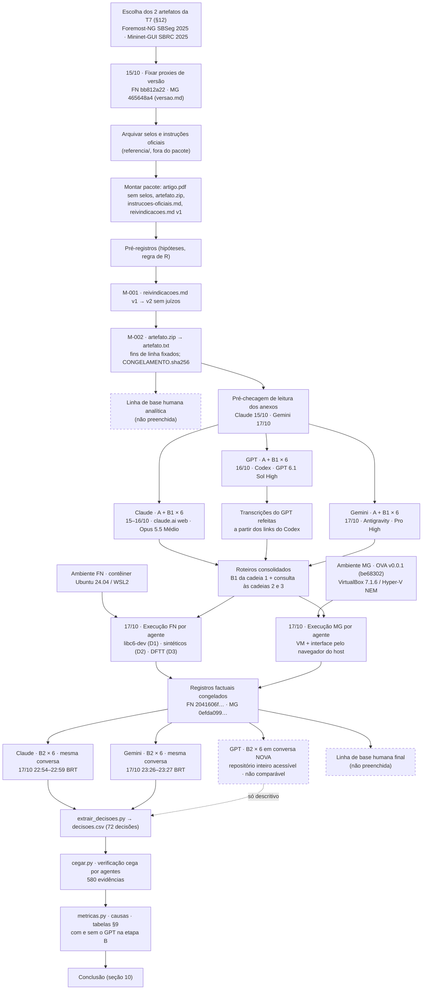

# Relatório final da T8 — LLMs reproduzem os selos F e R de artefatos do SBSeg e do SBRC?

**Estado:** versão de 18/10/2026. As 18 cadeias têm A, B1 e B2. O B2 do GPT foi aceito como **não comparável** (5.10). A verificação cega das evidências e as métricas estão prontas. A linha de base humana não foi preenchida e está declarada **ausente**. Nada foi commitado.

**Fontes dos números:**
- `runs/<artefato>/analise/metricas.md`, `decisoes.csv`, `por-reivindicacao.csv`, `evidencias.csv` e `notas-verificacao.md`;
- as respostas em `runs/<artefato>/llm-*/cadeia-N.md`;
- os selos oficiais em `runs/<artefato>/referencia/selos-oficiais.md`.

As contagens "sem o GPT" e as relações por cadeia foram calculadas à mão a partir desses arquivos. Todas as medidas são descritivas: com dois artefatos e referência constante, não há base para estatística inferencial.

**Protocolo:** [novo protocolo da T7](https://diegokreutz.github.io/leas_2026_2/tarefa_7/novo_protocolo.md), escrito a partir da [avaliação crítica](https://diegokreutz.github.io/leas_2026_2/tarefa_7/avaliacao_critica.md) da T7 deste grupo. "§N" sem outra indicação aponta para o protocolo.

**Grupo e papéis:**

| Parte | Quem fez | Fonte |
|---|---|---|
| Decisões de desenho, pacotes, pré-registros, roteiros, ferramentas, execuções de referência, verificação cega e este relatório | agentes Claude Code (Opus 5.5), com autorização e supervisão de Eduardo Prates Tiadoro | [decisoes-operacionais.md](../decisoes-operacionais.md) |
| Conversas do Claude (Anthropic) | Eduardo; a interface foi operada pelo agente Claude Code pela extensão Claude in Chrome, com autorização dele | [llms.md](../foremost-ng/llms.md), [controle-conversas.md](../controle-conversas.md) |
| Conversas do GPT (OpenAI) | Reinaldo Zimmer Wendt, no Codex | idem |
| Conversas do Gemini (Google) | Miguel Ângelo Bastos Muniz, no Antigravity | idem |
| Linha de base humana | não delegável e **não preenchida** (5.12) | `analise/pendencias-extracao.md` |

---

## 1. Objetivo, perguntas e hipóteses

**Objetivo (§1):** investigar se LLMs de provedores diferentes, seguindo as instruções oficiais da edição, reproduzem os selos F e R atribuídos ao artefato, e se a análise documental é consistente com a execução prática. A T8 aplica o protocolo a **dois** artefatos já estudados na T7 (§12): **Foremost-NG** (SBSeg 2025) e **Mininet-GUI** (SBRC 2025).

**Selos oficiais** (snapshots de 15/10/2026 em `referencia/selos-oficiais.md`): os dois artefatos receberam **D, F, S e R** no Salão de Ferramentas. Os selos nunca foram mostrados às LLMs.

### 1.1 Perguntas

As perguntas vêm do §1 do protocolo. Os pré-registros não as reescrevem; eles fixam as hipóteses e a regra de R de cada artefato.

| Pergunta | Formulação operacional | Resposta |
|---|---|---|
| Q1 | A decisão analítica (sem execução) de cada LLM coincide com o selo oficial? | 8.1 |
| Q2 | Ao receber evidências reais de execução, a LLM confirma, revisa ou contradiz a decisão analítica? A decisão final se aproxima do oficial? | 8.1 |
| Q3 | As três LLMs concordam entre si quando recebem exatamente as mesmas entradas? | 8.1 |
| Q4 | As evidências citadas pelas LLMs existem e sustentam o que elas afirmam? | 8.1 |

### 1.2 Hipóteses pré-registradas

As hipóteses foram registradas antes de qualquer Prompt A em [`foremost-ng/preregistro.md`](../foremost-ng/preregistro.md) e [`mininet-gui/preregistro.md`](../mininet-gui/preregistro.md). Elas tratam de **observabilidade** e de identidade de versão. Nenhuma prevê selo. O veredito de cada uma está em 8.2.

| ID | Hipótese (resumo fiel ao pré-registro) |
|---|---|
| H-FN1 | Um teste mínimo de carving com entrada externa identificada poderá gerar evidência de funcionamento observável, mas não de reprodução literal da Fig. 2. |
| H-FN2 | Sem `evidence2.dd` autenticada e sua receita, C6 ficará sem reprodução verificável, mesmo que outra imagem produza arquivos dos mesmos tipos. |
| H-FN3 | Sem chave VT válida e entrada identificada, não haverá observação direta da consulta C5; um aviso de ausência de chave não é evidência da consulta. |
| H-FN4 | A falta de fixtures e gabaritos autorais limitará a conclusão sobre C1–C4; um caso externo positivo não prova cobertura geral dos quatro formatos. |
| H-MG1 | Os procedimentos de C4/C5 bastarão para planejar observações qualitativas, mas a falta de configurações e saídas de referência reduzirá a comparabilidade quantitativa. |
| H-MG2 | O teste mínimo poderá observar C1/C2; C3/C6 exigirão passos complementares, porque o README não traz receita para essas afirmações. |
| H-MG3 | A incerteza sobre a OVA poderá impedir que os resultados sejam atribuídos ao proxy, mesmo que a aplicação abra. Confirmar o SHA ou comparar o código inteiro pode contrariar a hipótese. |

O protocolo também propõe três hipóteses gerais:
- **H1:** na etapa A, as LLMs tendem a "Indeterminado" em F;
- **H2:** com o mesmo registro de execução, as LLMs convergem na decisão de F;
- **H3:** as divergências em R vêm da interpretação de "principais reivindicações" e diminuem quando a lista é fixada.

Os pré-registros **não** as adotaram. Em 8.2 elas são confrontadas com os dados como análise **não pré-registrada**.

---

## 2. Método

### 2.1 Artefatos e versões fixadas

Nenhum dos dois comitês publicou o SHA avaliado. Os dois commits são **proxies de 2025**, escolhidos e justificados antes da coleta em `versao.md`.

| | Foremost-NG (SBSeg 2025) | Mininet-GUI (SBRC 2025) |
|---|---|---|
| Commit fixado (proxy) | `bb812a22cb06ef87b5a2d877dfb6f40eb12d460d` (08/07/2025; igual à `main` em 15/10/2026) | `465648a4425a4457af0348ab951cf7f71d37a86f` (22/04/2025; merge da branch `sbrc2025`) |
| Por que é proxy | último commit antes do evento; o código funcional já estava público em 14/06/2025; não há tag nem apêndice que fixe o checkout do comitê | último commit da `main` antes do evento; o README desse ponto tem "Teste mínimo" e "Experimentos" |
| Software executado | o próprio `bb812a22` | o da OVA da release `v0.0.1`, commit **`be68302`**: ancestral do proxy, com o mesmo backend e o mesmo frontend (5.7) |
| Insumos ausentes já conhecidos antes de A | `evidence2.dd` (Fig. 2) e chave VirusTotal | link da VM no README inativo; OVA obtida na release |
| Fonte | [`foremost-ng/versao.md`](../foremost-ng/versao.md) | [`mininet-gui/versao.md`](../mininet-gui/versao.md) |

### 2.2 Pacote de entrada

Cada artefato tem um `pacote/` com os mesmos bytes para os três provedores, conferidos por `MANIFESTO.sha256` ([auditoria-pacotes.md](../auditoria-pacotes.md)).

| Anexo de A | Conteúdo | Foremost-NG (SHA-256) | Mininet-GUI (SHA-256) |
|---|---|---|---|
| `artigo.pdf` | artigo publicado com as 4 imagens de selo da p. 1 trocadas por imagens brancas; texto extraível igual ao do original | `d9b12aa4…e9715` | `4e3ff858…2bf08` |
| `artefato.txt` | apresentação em arquivo único do `git archive` do commit fixado (ver abaixo) | `6de9ecff…30446` (21 arquivos de texto) | `5e1da9b3…3c8eb` (42) |
| `instrucoes-oficiais.md` | critérios F/R da edição correta, com URL de proveniência | `446e5f94…90a47` | `fc8e01dd…89059` |
| `reivindicacoes.md` (v2) | lista fixada de reivindicações e regra de R | `3d27bc26…2dbac` | `100366e5…ed0bc` |

**`artefato.txt` (M-002).** O Claude não aceita ZIP, e o Gemini lê no máximo dez arquivos por ZIP. O `artefato.zip` (44 e 52 entradas) foi então trocado, para os três provedores, por um arquivo único gerado por [`ferramentas/achatar_artefato.py`](../../ferramentas/achatar_artefato.py). Ele traz um índice com tamanho e SHA-256 de todas as entradas e o texto integral de cada arquivo de texto, com número de linha. Binários aparecem só no índice. Os fins de linha foram fixados com `-text` no `.gitattributes`. Fonte: adendo de [auditoria-pacotes.md](../auditoria-pacotes.md).

### 2.3 Lista de reivindicações (`reivindicacoes.md` v2) e regra de R

A v1 trazia juízos do grupo junto das reivindicações ("indisponível", "inconclusivo", "bloqueado": 16 ocorrências no FN e 7 no MG). Antes de qualquer Prompt A, ela foi reescrita no formato do §4.4, sem juízos (**M-001**, [registro-mudancas-pre-A.md](../registro-mudancas-pre-A.md)). A v1 foi preservada como `criterios-observacao.md`. IDs, regra de R e reivindicações principais não mudaram.

| Artefato | Reivindicações | Regra de R | Critério de reprodução |
|---|---|---|---|
| Foremost-NG | C1 EVTX, C2 scripts, C3 Mach-O, C4 ELF, C5 VirusTotal, C6 Fig. 2 (`evidence2.dd`), C7 arquitetura de parsers | O README não marca reivindicações; **R se C1–C6 forem reproduzidas**. C7 fica fora da regra. | comportamento esperado observado; em C6, arquivos e offsets da Fig. 2; contagens do VirusTotal não precisam coincidir |
| Mininet-GUI | C1–C6 = as seis contribuições do artigo (p. 2, §1) | "Experimentos" do README marca duas: **R se C4 (geração Single/Linear/Tree) e C5 (WebShell) forem reproduzidas** | comportamento esperado observado; em C4, nos três modelos |

### 2.4 Prompts A, B1 e B2

Os textos são os dos §5, §6.1 e §6.4, gerados por [`ferramentas/gerar_prompts.py`](../../ferramentas/gerar_prompts.py) e guardados em `pacote/prompts/`. Antes de qualquer A, foram feitas três adaptações, iguais para os três provedores:

1. `artefato.zip` → `artefato.txt`;
2. a proibição de navegar foi ampliada para memória, outras conversas, projetos e conectores;
3. `{CONDICAO}` do B2 foi preenchido uma vez, depois da execução:
   - **FN:** "atende (Linux…; contêiner Docker com Ubuntu 24.04 sobre WSL2…)";
   - **MG:** "atende parcialmente (VM dos autores no VirtualBox 7.1.6 com 8 GB de RAM, mas sobre o Hyper-V em modo NEM e com o navegador do host…)".

O B2 anexa só o `registro-factual.md` congelado. Hashes de `prompt-B2.txt`: FN `365f9f76…5c0a`; MG `e50a597c…c9a9`.

### 2.5 Cadeias

São 3 provedores × 2 artefatos × 3 cadeias = **18 conversas** e **36 decisões por artefato** (3 LLMs × 3 cadeias × 2 etapas × 2 selos). Fonte: [controle-conversas.md](../controle-conversas.md) e os cabeçalhos das cadeias.

| Provedor | Modelo e esforço exibidos | Interface efetiva | A/B1 | B2 | Transcrição |
|---|---|---|---|---|---|
| Claude (Anthropic) | `Opus 5.5 Médio` (`claude-opus-5-5`, `effort_level=medium`) | claude.ai web, chat avulso, operado pelo agente por Claude in Chrome; `bash_tool` e skills ativos e não desligáveis | 15/10 23:13 → 16/10 00:26 BRT | 17/10 22:54–22:59 BRT, mesma conversa; registro `2041606f…`/`0efda099…` | API do claude.ai, SHA-256 conferido com a página |
| GPT (OpenAI) | `GPT 6.1 Sol`, `High` (confirmado por Reinaldo em 18/10/2026) | **Codex** (agente com workspace e terminal) | 16/10, horário não registrado | 17–18/10, em **conversa nova** e outro workspace: **não comparável** (5.10) | A/B1: JSON dos links (`transcrever_codex.py`); B2: Session Exporter (`extrair_b2_session_export.py`), não literal |
| Gemini (Google) | `Gemini Pro (High)` | **Antigravity**, subagente isolado `revisor-cega-gemini`, só leitura | 17/10 13:52–13:59 BRT | 17/10 23:26–23:27 BRT, mesma conversa; hash completo do registro conferido | `transcript_full.jsonl` |

Pré-checagem de leitura dos anexos em conversa descartável: Claude em 15/10 23:07 BRT; Gemini em 17/10 13:49 BRT; GPT sem registro. Nas transcrições de A/B1 dos três provedores não se encontrou acesso fora de `pacote/` nem execução do artefato (adendo de 17/10).

### 2.6 Roteiro consolidado, execução de referência e congelamento

**Roteiro (§6.2 e §6.5).** Para cada artefato, `execucao/roteiro-consolidado.md` é a união dos B1 da **cadeia 1** dos três provedores. Cada passo traz a sua origem, e os passos [NÃO DOCUMENTADO] ficam em bloco separado. Os B1 das cadeias 2 e 3 foram consultados só para achar passo essencial ausente:
- **FN:** entraram o teste DFTT #11/#12 (P39–P41) e a conferência da árvore (P11);
- **MG:** entraram a comparação com o namespace da VM (E27) e o Pingall com sessão `h1` após remoção (E30).

Tempo máximo: 2 h por reivindicação e 2 h para o teste mínimo.

**Ambientes.**
- **FN:** contêiner Docker com Ubuntu 24.04 (`noble-20250619`), apt fixado em `20250708T190020Z`, sobre WSL2.
- **MG:** VM dos autores (OVA `v0.0.1`, SHA-256 `9018352d…`), VirtualBox 7.1.6 r167084, 8192 MB e 2 vCPUs, sobre o Hyper-V/NEM.

**Execução.** Uma por artefato, em 17/10/2026: FN das 18:34 às 18:50 UTC; MG das 18:34:47Z às 19:03:35Z. Foram no mesmo host, em horários sobrepostos, e operadas por agentes Claude Code (5.3). Houve gravação com `script`, um registro por passo (comando, código, duração, saída, hashes) e, no MG, 65 capturas com carimbo UTC. Desvios classificados de D0 a D3.

**Congelamento** antes de qualquer B2 (`execucao/CONGELAMENTO.sha256`):

| Arquivo | Foremost-NG | Mininet-GUI |
|---|---|---|
| `registro-factual.md` | `2041606f1236e737f2b6191d2ff9f06944c7fea87f32996f0f12fff2d51281fb` | `0efda099a39c28b4fd3a91e0c5e38290c3238aa87ccde3281ad3ec9062df9b0e` |
| `roteiro-consolidado.md` | `4ee7df70…bfe9a0f` | `7b628372…543ce` |
| `preregistro.md` | `26eecf29…71eb3` | `53fe6ca2…51821` |

As 12 cadeias do Claude e do Gemini registram no cabeçalho o hash do registro anexado no B2, igual ao congelado. No GPT, o registro foi lido do disco no novo workspace, e os bytes não foram conferidos.

### 2.7 Análise

1. [`extrair_decisoes.py`](../../ferramentas/extrair_decisoes.py) gerou `analise/decisoes.csv` e `por-reivindicacao.csv` a partir do último JSON de `## Resposta A` e de `## Resposta B2` de cada cadeia. Foram 72 decisões, sem pendência entre as LLMs; as 8 pendências são os arquivos `humano/` não preenchidos.
2. [`cegar.py`](../../ferramentas/cegar.py) trocou os provedores por M1/M2/M3 e gravou a chave fora do repositório. Sessões de agente classificaram as evidências sem ver a chave (5.11).
3. [`metricas.py`](../../ferramentas/metricas.py) gerou `analise/metricas.md`, com a chave. As colunas "Causa da divergência" e "Evidência-chave" (7.1) e "Passo do registro que motivou" (7.2) foram preenchidas à mão, a partir das respostas B2.

---

## 3. Fluxograma do que foi feito (item 13)

Os nós tracejados não foram feitos ou não entram na comparação principal.

---

## 4. Parâmetros fixos, variados e medidos (§3.1)

O §3.1 manda copiar esta tabela para `preregistro.md` e preencher "Valor adotado" antes da coleta. **Isso não foi feito** (5.13). Os valores abaixo foram reconstruídos de documentos datados ("FN" = Foremost-NG; "MG" = Mininet-GUI).

| Grupo | Parâmetro | Recomendado (§3.1) | Valor adotado | Onde está registrado |
|---|---|---|---|---|
| Fator | LLM / provedor | OpenAI, Anthropic, Google | GPT (OpenAI), Claude (Anthropic), Gemini (Google) | `llms.md` |
| Fator | Etapa | A, B | A (analítica), B1 (plano, sem decisão), B2 (decisão após execução) | `pacote/prompts/` |
| Fator | Selo | F, R | F, R | idem |
| Fator | Cadeia | 1, 2, 3 | 1, 2, 3 por LLM e artefato; 18 conversas | `controle-conversas.md` |
| Fator (opcional) | Condição agêntica | sim / não | **não** adotada como condição separada; mesmo assim, GPT e Gemini rodaram em interfaces agênticas (5.1) | `decisoes-operacionais.md` |
| Fixo | Artefato e edição | um artefato | **dois**: Foremost-NG (SBSeg 2025) e Mininet-GUI (SBRC 2025) | `versao.md` |
| Fixo | Versão do artefato | SHA avaliado pelo comitê | proxies `bb812a22` (FN) e `465648a4` (MG); VM do MG em `be68302` | `versao.md` |
| Fixo | Pacote de entrada | 4 arquivos + manifesto | `artigo.pdf` sem selos, `artefato.txt`, `instrucoes-oficiais.md`, `reivindicacoes.md` v2 | `pacote/MANIFESTO.sha256` |
| Fixo | Lista de reivindicações | C1 a Cn | FN C1–C7; MG C1–C6 | `pacote/reivindicacoes.md` |
| Fixo | Regra para R | as indicadas pelos autores ou C1–Cn | FN: C1–C6; MG: C4 e C5 | idem |
| Fixo | Modelo e versão | nome exibido; data e hora | Claude `Opus 5.5 Médio`; GPT `GPT 6.1 Sol`, High (confirmado por Reinaldo em 18/10/2026); Gemini `Gemini Pro (High)`; datas em 2.5 | `llms.md`, cabeçalho das cadeias |
| Fixo | Nível de raciocínio | o mesmo nível nominal | **diferente**: Claude Médio; GPT High (confirmado por Reinaldo); Gemini High | `llms.md` |
| Fixo | Interface | chat com upload para as três | **diferente**: claude.ai web (chat); Codex (agente); Antigravity (subagente só leitura) | `llms.md`, `decisoes-operacionais.md` |
| Fixo | Navegação web | desativada | Claude: desabilitada; Gemini: desativada no subagente; GPT: estado não registrado; nas três, proibida no Prompt A | `llms.md`, `prompt-A.txt` |
| Fixo | Memória e personalização | desativadas | Claude: memória pausada, sem busca em conversas; Gemini: contexto isolado; GPT: estado não registrado | `llms.md` |
| Fixo | Temperatura | padrão (só via API) | não se aplica (nenhuma API usada) | — |
| Fixo | Prompts | texto idêntico | idêntico entre provedores, com as 3 adaptações de 2.4; B2 do GPT em conversa nova (5.10) | `pacote/prompts/LEIA-ME.md` |
| Fixo | Informação vedada | selos, outras LLMs, planejamento | selos (inclusive os grafismos do PDF), respostas de outros provedores, `preregistro.md`, protocolo e conversas de planejamento. Exceção: no B2 do GPT, `referencia/instrucoes-oficiais.md`, evidências brutas e roteiro ficaram acessíveis (5.10) | `llms.md`, adendo de 18/10 |
| Execução | Ambiente | o indicado pelos autores | FN: Linux em contêiner Ubuntu 24.04/WSL2 (não VM); MG: VM dos autores | `registro-factual.md` §1 |
| Execução | Recursos | ≥ requisitos do README | FN: 16 CPUs lógicas, 8,16 GB de RAM; MG: 8192 MB, 2 vCPUs | idem |
| Execução | Versões das dependências | `--version` | FN: gcc 13.3.0, make 4.3, glibc 2.39, OpenSSL 3.0.13, libcurl 8.5.0; MG: Mininet 2.3.0, OVS 2.13.1, Python 3.8.5, Node 18.20.7; Ryu ausente | idem |
| Execução | Tempo máximo por reivindicação | 2 h | 2 h por reivindicação e 2 h para o teste mínimo; nenhum bloco chegou perto | `roteiro-consolidado.md` |
| Execução | Critério de desistência | erro D2 em passo essencial ou tempo | definido em cada roteiro; não acionado | idem |
| Execução | Classes de desvio | D0–D3 | D0–D3 | `registro-factual.md` |
| Execução | Tolerância numérica | ex.: 5% ou a dos autores | nenhuma (os autores não publicam valores); critério = comportamento observado | `reivindicacoes.md` |
| Execução | Contato com autores | no máximo 1 mensagem | FN: pedido de `evidence2.dd` redigido e **não enviado**; MG: nenhum | `registro-factual.md` |
| Medida | Decisão | Atribuir / Não atribuir / Indeterminado | idem, no JSON de A e B2 | `analise/decisoes.csv` |
| Medida | Confiança | 0–100 | idem; o Prompt A a define como "confiança de que o comitê atribuiu o selo" | idem |
| Medida | Evidências citadas | correta / mal interpretada / inexistente / não verificável | idem, por verificação cega feita por agentes | `analise/evidencias.csv` |
| Medida | Arquivos efetivamente lidos | seção A da resposta | seção A, mais as chamadas de ferramenta registradas em `desvios` | `cadeia-N.md` |
| Medida | Status por passo | sucesso / falha / inconclusivo | sucesso / falha / inconclusivo / **bloqueado** / não executado | `registro-factual.md` |
| Medida | Tempo e custo | duração da conversa e dos passos | passos: `passos.tsv`, `terminal.txt`; conversas: horários (Claude, Gemini) ou duração dos turnos (GPT A/B1) | idem, `controle-conversas.md` |
| Limiar | Consistência com o oficial | modal = oficial e estabilidade ≥ 2/3 | o do protocolo, sem alteração | §8 |
| Limiar | Consistência entre LLMs | as três com a mesma modal | idem; na etapa B, calculado também sem o GPT (só Claude e Gemini) | adendo de 18/10 |
| Limiar | Reprodução de uma reivindicação | tolerância ou comportamento observado | comportamento esperado de `reivindicacoes.md` observado | `reivindicacoes.md` |

---

## 5. Desvios e ameaças à validade

Cada item diz o que aconteceu, o efeito possível e a fonte.

### 5.1 Interfaces diferentes (crítica §4.4)

- **O que aconteceu:** o plano era chat com anexos no app desktop, sem agentes. Na prática:
  - o Claude rodou no claude.ai web, com `bash_tool` e skills ativos (de 8 a 12 chamadas de ferramenta por resposta A para ler `artefato.txt`);
  - o GPT rodou no **Codex**, um agente que leu os anexos do disco;
  - o Gemini rodou no **Antigravity**, como subagente isolado de só leitura.
  
  O grupo manteve as três coletas e declarou o desvio.
- **Efeito possível:** compara-se "produto + modelo". A leitura de PDF e de arquivos longos difere entre as interfaces. A busca nas transcrições de A/B1 não encontrou acesso fora do pacote. O B2 do GPT é tratado à parte (5.10).
- **Fonte:** [decisoes-operacionais.md](../decisoes-operacionais.md) (adendo de 17/10); [llms.md](../foremost-ng/llms.md); [controle-conversas.md](../controle-conversas.md); campo `desvios` de cada `cadeia-N.md`.

### 5.2 Esforço Médio × High

- **O que aconteceu:** o Claude rodou com esforço `Médio`; o GPT e o Gemini, com `High`. Modelo e esforço do GPT foram informados de memória e não foram confirmados até 18/10/2026.
- **Efeito possível:** diferenças entre o Claude e os outros podem vir do nível de raciocínio. Os níveis nominais não são equivalentes entre provedores.
- **Fonte:** [llms.md](../foremost-ng/llms.md); [decisoes-operacionais.md](../decisoes-operacionais.md); cabeçalhos das cadeias.

### 5.3 Execução feita por agente, não pelo aluno

- **O que aconteceu:** o aluno autorizou que agentes Claude Code fizessem a execução de referência e que ela contasse como dele. No MG, a interface web foi operada por eventos CDP enviados ao Edge headless do host, com incidentes de automação registrados.
- **Efeito possível:** erros do executor afetam igualmente o registro de todos os provedores (§13). A interação automatizada pode diferir da de um usuário humano.
- **Fonte:** [decisoes-operacionais.md](../decisoes-operacionais.md); `mininet-gui/execucao/registro-factual.md` §1.5 e §6.

### 5.4 Exposição prévia do executor

- **O que aconteceu:** o agente que operou a execução também operou as conversas do Claude, apesar da decisão de 15/10 de que o orquestrador não conduziria conversas avaliadoras. Ao testar o extrator, ele viu decisões da etapa A e a coluna `oficial`. O executor é da mesma família de modelos de um dos avaliadores. As sessões de execução receberam a instrução de ler só os roteiros B1.
- **Efeito possível:** o conhecimento prévio pode influenciar a escolha e a redação dos passos. A mitigação é que o registro é só de fatos e é idêntico para os três provedores.
- **Fonte:** [decisoes-operacionais.md](../decisoes-operacionais.md) (decisão de 15/10 e adendo de 17/10).

### 5.5 `libc6-dev` ausente no ambiente inicial do Foremost-NG

- **O que aconteceu:** a imagem preparada instalou os pacotes do `Dockerfile` dos autores com `--no-install-recommends`, e faltou o `libc6-dev`. P04 falhou (`ctype.h`), e P05, P06 e P08 também. O pacote foi instalado (P00b, D1), e depois P04-2, P05-2 e P06-2 terminaram com código 0.
- **Efeito possível:** a falha é do ambiente, e as LLMs recebem as duas tentativas. Claude, Gemini e GPT (FN-1, FN-2) atribuíram a falha ao ambiente, não ao artefato. O ambiente é contêiner sobre WSL2, não VM Ubuntu.
- **Fonte:** `foremost-ng/execucao/registro-factual.md` §1 e §4.

### 5.6 Hyper-V em modo NEM no Mininet-GUI

- **O que aconteceu:** o VT-x não ficou disponível para o VirtualBox, e a VM rodou sobre a API do Hyper-V (NEM). O host tinha cerca de 725 MB livres no início, e a execução do FN ocorria em paralelo. A interface foi aberta pelo navegador do host, porque a VM não tem ambiente gráfico. O B2 declara "atende parcialmente".
- **Efeito possível:** tempos e vazões dependem desse modo. Nenhuma reivindicação tem valor de desempenho, e Claude, Gemini e GPT disseram não reduzir a decisão por isso.
- **Fonte:** `mininet-gui/execucao/registro-factual.md` §1.1, §1.4 e §6; `prompt-B2.txt`.

### 5.7 Commit da VM diferente do commit da documentação

- **O que aconteceu:** as LLMs avaliaram a documentação de `465648a4`, e a execução rodou `be68302`, ancestral do proxy, a 16 commits dele. Entre os dois mudam só `README.md`, `run.sh` (linha `nvm use 18.20.7`) e dois arquivos de exemplo; backend e frontend são idênticos.
- **Efeito possível:** é diferença de versão da documentação, não do software. As três LLMs aceitaram atribuir os resultados ao artefato avaliado. Isso continua sem provar qual checkout o comitê examinou.
- **Fonte:** [`mininet-gui/versao.md`](../mininet-gui/versao.md) (adendo de 16/10); registro factual §1.3.

### 5.8 Limite de uso no Claude FN-3

- **O que aconteceu:** o limite de 5 h da conta foi atingido por volta de 00:00 BRT de 16/10. O B1 do FN-3 parou e foi retomado com a frase fixa `Continue exatamente de onde parou.`
- **Efeito possível:** essa cadeia tem uma mensagem a mais. O roteiro usou só o B1 da cadeia 1.
- **Fonte:** [controle-conversas.md](../controle-conversas.md) (notas do Claude, item 1).

### 5.9 Exports do GPT refeitos a partir dos links (A/B1)

- **O que aconteceu:** os primeiros exports foram escritos pelo próprio modelo (Session Exporter): o texto foi alterado (senha da VM redigida), e no MG-1 faltava o B1. A/B1 foram retranscritos do JSON público dos links, com as 48 mensagens conferidas literalmente. Cada conversa ganhou um 3º turno fora do roteiro.
- **Efeito possível:** as transcrições omitem raciocínio, visualizações do PDF e chamadas de ferramenta. O B2 acabou feito fora dessas conversas (5.10).
- **Fonte:** [controle-conversas.md](../controle-conversas.md) (notas do GPT).

### 5.10 B2 do GPT em conversa nova: não comparável

- **O que aconteceu:** as 6 respostas B2 do GPT foram geradas em **conversas novas** do Codex, em outro workspace, com o contexto "restaurado" a partir dos exports escritos pelo próprio modelo. Elas não vieram da mesma conversa de A/B1, como exigem o §3 e o §6.4. Nesse workspace o repositório inteiro estava acessível:
  - FN-1 e MG-1 leram `referencia/instrucoes-oficiais.md`;
  - FN-3 e MG-3 leram evidências brutas da execução e o roteiro consolidado;
  - não se encontrou leitura de `selos-oficiais` nem de respostas de outros provedores.
  
  O texto vem do Session Exporter (não literal) e foi extraído por `ferramentas/extrair_b2_session_export.py`. Reinaldo informou que não consegue refazer o B2 nas conversas originais, e o aluno aceitou o material como está em 18/10/2026.
- **Efeito na análise:** as decisões B do GPT aparecem só de forma descritiva. Elas ficam **fora** da matriz A→B, da concordância entre LLMs na etapa B e do critério de consistência; essas medidas são apresentadas com o GPT (como em `metricas.md`) e sem ele. **A comparação A→B do GPT não é válida:** a etapa B não partiu da mesma conversa, e o GPT teve acesso a material que Claude e Gemini não receberam.
- **Fonte:** [decisoes-operacionais.md](../decisoes-operacionais.md) (adendo de 18/10); [controle-conversas.md](../controle-conversas.md); cabeçalhos das cadeias do GPT.

### 5.11 Verificação "cega" feita por agentes

- **O que aconteceu:** sem colega disponível, o cegamento foi feito por `cegar.py`, e a classificação, por sessões de agente que não leram a chave nem as pastas `llm-*`, só `verificacao-cega/`, o pacote e o registro factual. Pistas de estilo (marcações do Codex, documentos do Claude Docs) podem permitir identificar o provedor.
- **Efeito possível:** o cegamento é parcial. O verificador é um agente da mesma família de um dos avaliados. A classe mede se o local citado existe e diz o que a resposta afirma, não se o juízo sobre o critério está certo (`notas-verificacao.md`, critério 1).
- **Fonte:** [decisoes-operacionais.md](../decisoes-operacionais.md) (adendo de 18/10); `analise/notas-verificacao.md`.

### 5.12 Linha de base humana ausente

Os quatro arquivos `humano/` continuam com o modelo, sem preencher, e `extrair_decisoes.py` registra 4 pendências por artefato. Pela [decisão de 15/10](../decisoes-operacionais.md), o agente não os preenche, e a linha de base é declarada **ausente**. Se tivesse sido feita, ela não seria cega: os autores já conheciam os selos e os resultados da T7.

### 5.13 Tabela §3.1 não preenchida antes da coleta

Os pré-registros não contêm a tabela de parâmetros. A seção 4 a reconstrói a partir de documentos anteriores a A (`llms.md`, `versao.md`, `reivindicacoes.md`), mais os registros posteriores das interfaces usadas.

### 5.14 Outros desvios registrados

| Desvio | Efeito possível | Fonte |
|---|---|---|
| Os dois commits são proxies; o SHA do comitê não é público | divergência com o oficial pode ter causa "diferença de versão" | `versao.md` |
| FN: `evidence2.dd` e chave VirusTotal não obtidos; a mensagem aos autores foi redigida e não enviada | C5 com chave e C6 bloqueados; o canal de "rebuttal" não foi usado | registro FN §4; `mensagem-autores.md` |
| FN: entradas de C1–C4 montadas pelos revisores (D2) ou públicas (D3) | evidência complementar, não autoral | registro FN §2.2–2.3 |
| MG: Ryu ausente na VM, sem Internet | passo 8 do teste mínimo incompleto | registro MG §5 |
| MG: quantidades de C4 e comandos de C5 escolhidos pelos revisores | valores rotulados como D2 | registro MG §2 e §5 |
| Claude: claude.ai web no lugar do app; uma conversa vazia na abertura do MG-2; troca acidental de seletor sem envio | nenhuma mensagem avaliadora afetada | `controle-conversas.md` |
| Gemini: raciocínio omitido nas transcrições | a análise usa só o texto das respostas | cabeçalhos do Gemini |
| `artefato.txt` traz binários só no índice | limitação igual para os três | `auditoria-pacotes.md` |
| B2 na mesma conversa de A (ancoragem, §13); sem a cadeia extra opcional | a estabilidade 3/3 pode refletir ancoragem | §13 |

---

## 6. Resultados da execução por reivindicação

Resumo dos dois registros factuais congelados, sem juízo de selo. Status e rótulos de desvio são os do registro.

### 6.1 Foremost-NG

Fonte: [`foremost-ng/execucao/registro-factual.md`](../foremost-ng/execucao/registro-factual.md) (`2041606f…81fb`).

| Item | Passos | Observado |
|---|---|---|
| F: instalação e uso | P01–P08, P00a/b, P04-2–P06-2 (D0/D1) | `git clone` funcionou. `make` na raiz, como manda o artigo p. 6: "no makefile found". O `.tar.gz` do README não existe; foi usado o zip do commit. `make` em `src/` falhou sem `libc6-dev` e, depois de instalá-lo (D1), `make`, `sudo make install`, `man`, `-h` e `-V` terminaram com código 0. O manual não lista `evtx`, `elf`, `macho` nem `script`. |
| F: teste mínimo | P14a–P16-G-cmp (D2) | `min.dd`: script recuperado idêntico. `disk.img` com a sintaxe literal do artigo (`-o /temp/output/carved`): a 1ª execução falhou por permissão (o programa não cria diretórios-pai); com o diretório criado, saíram 5 arquivos: o ELF (prefixo de 73.752 de 87.200 B), o script idêntico e 3 `.evtx` de dentro do ELF embutido. Não foi gerado `recovery.log`. |
| C1 EVTX | P17b–P19b, P28b–P28d, P19a | Sintético: extraído (prefixo de 65.536 de 69.632 B) e lido com 0 eventos. Público (D3): recuperado com 10.570.240 B, até o fim da imagem; os primeiros 1.118.208 B são o original idêntico; 1601 eventos e XML idênticos. DFTT: 0 EVTX. |
| C2 scripts | P20b–P21b, P28d | Os 7 válidos extraídos idênticos. Os 2 com menos de 32 B não extraídos. Os 2 com shebang e só comentários (62 e 45 B) **extraídos**. |
| C3 Mach-O | P23b–P24b-conf, P28d, P25 | Fat sintético extraído idêntico (2/2). Thin 64-bit sintético **não extraído** (0/2). Mach-O reais, `lipo` e `otool`: bloqueados (sem macOS). |
| C4 ELF | P26b–P27b-conf, P28d, P28d-readelf | ELF32 sintético extraído idêntico. Três ELF reais extraídos como prefixos que terminam no fim do último `PT_LOAD`; `readelf -h -l` lê cabeçalho e segmentos, mas acusa erro na tabela de seções. DFTT: 0 ELF. |
| C5 VirusTotal | P07, P29a/b, P30–P33 | Sem chave e com `-x`: um aviso por arquivo, extração normal, código 0 e coluna VT `Clean (0)` (sem `-x`: `N/A`). Consulta com chave: bloqueada. Chave inválida: não executado. |
| C6 Fig. 2 | P08/P08-2, P34–P37 | Bloqueado: `evidence2.dd` não obtido; o comando da figura termina com `File not found`. |
| C7 arquitetura (fora de R) | P38a/b | `s_spec` e `init_builtin` existem; `extract_file` despacha por uma cadeia `if/else if` com um ramo por tipo. |
| D3: DFTT | P39–P41-t | #11: 15 esperados, 14 recuperados no setor, 10 corretos por MD5. #12 (sem `-d`): 10, 6 e 1. `-t evtx,elf,exe`: 0 arquivos. |

### 6.2 Mininet-GUI

Fonte: [`mininet-gui/execucao/registro-factual.md`](../mininet-gui/execucao/registro-factual.md) (`0efda099…9b0e`).

| Item | Passos | Observado |
|---|---|---|
| Teste mínimo (README 1–9) | E02–E17 | Passos 1–6 e 9 com o resultado descrito pelos autores; passo 7 (iperf, opcional): 6,62 Gbit/s; passo 8 (opcional): controlador remoto, segunda topologia e link verde criados, sem Ryu e com 2 de 12 pares no Pingall. |
| C1 interface/grafo | E10–E12; E28a/b (D2) | Elementos aparecem no grafo e nas abas; a posição se mantém depois de recarregar; nós da paleta podem ser ligados; gerações seguidas sem reset sobrepõem nós. |
| C2 emulação | E12–E13; E29, E31 (D2) | Pingall na interface: 2/2, 20/20 e 2/2 pares; API com `start=true`. |
| C3 edição em tempo real | E16; E28b, E29, E30a–d (D2) | Adição e remoção com a rede ativa, sem reinício. Depois das remoções, o Pingall falha com HTTP 500, e `/links` mantém o nó removido. |
| C4 geração (regra de R) | E19–E22; E18, E23 (D2) | Single 3, Linear 3×2 e 2×1, Tree 2/2: contagens iguais às escolhidas, no grafo e na API. |
| C5 WebShell (regra de R) | E14, E24; E25–E27 (D2) | `ip addr show` nas abas `h1` e `h2` mostra a interface e o IP de cada nó; o shell da aba está no namespace do nó. |
| C6 regras de fluxo | E31–E32 (D2) | A Flow Table de `s1` mostra 5 regras; não há controle para inserir ou remover regras. |

---

## 7. Comparação com a avaliação oficial e entre LLMs

**Estabilidade.** Nas 24 células LLM × etapa × selo × artefato, as três cadeias deram a mesma decisão: estabilidade 3/3 em todas, sem nenhum empate de moda.

**Cobertura.** Proporção de decisões diferentes de Indeterminado, em F e R juntos:

| Etapa | Foremost-NG | Mininet-GUI |
|---|---|---|
| A | GPT 6/6; Claude 6/6; Gemini 3/6 | GPT 3/6; Claude 0/6; Gemini 0/6 |
| B | 100% nas três (GPT só descritivo) | 100% nas três (GPT só descritivo) |

### 7.1 Tabela comparativa (§9; item 10; Q1, Q2)

Oficial = Atribuir em todas as linhas (os dois artefatos receberam F e R). "Causa da divergência" usa uma das causas do §8 e se apoia na resposta B2 da própria LLM. Quando só a etapa A diverge e ela é Indeterminado, a causa é "n.a.": o Prompt A manda usar Indeterminado quando a decisão depende de execução. **\*** = decisão B do GPT não comparável (5.10).

**Foremost-NG**

| LLM | Selo | Oficial | Analítica (modal, estab.) | Após execução (modal, estab.) | Coincide (A / B) | Mudou? | Causa da divergência | Evidência-chave |
|---|---|---|---|---|---|---|---|---|
| OpenAI | F | Atribuir | Não atribuir (3/3) | Não atribuir (3/3)\* | Não / Não\* | Não | Interpretação do critério | As 3 B2 aceitam a execução (P04-2, P05-2, P15a, P16a) e negam F só porque o README (`README.md:21–35, 74–85`) não traz versões nem exemplo mínimo concreto; a confiança de que o comitê atribuiu sobe para 15–25. |
| OpenAI | R | Atribuir | Não atribuir (3/3) | Não atribuir (3/3)\* | Não / Não\* | Não | Insumo indisponível publicamente | Sem `evidence2.dd` (P08-2, P34–P37) e sem chave VT (P31–P33); as B2 somam C2 e C3 contrariados em P21b e P24b. |
| Anthropic | F | Atribuir | Não atribuir (3/3) | Não atribuir (3/3) | Não / Não | Não | Interpretação do critério | A B2 diz que os critérios de execução foram "resolvidos a favor" (P04-2, P05-2, P16a, P39) e que falham "exclusivamente" os de documentação: dependências e versões (`README.md:31–35`), exemplo mínimo e instalação literal (P02, P03, P06-2). A confiança de que o comitê atribuiu F é 65 nas 3 cadeias. |
| Anthropic | R | Atribuir | Não atribuir (3/3) | Não atribuir (3/3) | Não / Não | Não | Insumo indisponível publicamente | C6 sem `evidence2.dd` (P34, P08-2): "só isso já basta" (c2); C1–C4 sem entrada dos autores; C5 sem chave (P31–P32). Defeitos de código em C2/C3 (P21b, P24b) citados como razão adicional. |
| Google | F | Atribuir | Indet. (3/3) | Atribuir (3/3) | Não / Sim | Sim | n.a. (A Indet. por falta de execução; B coincide) | P04-2, P05-2, P06-2, P13a/b, P15a, P15b-2, P39, P41. |
| Google | R | Atribuir | Não atribuir (3/3) | Não atribuir (3/3) | Não / Não | Não | Insumo indisponível publicamente | "Ausência total de dados de entrada dos autores", em especial `evidence2.dd` (P08-2/P36); falhas complementares em C2 (P21b), C3 (P24b) e C5 (P29a/b). |
| Humano | F | Atribuir | ausente | ausente | n.d. | n.d. | — | linha de base não preenchida (5.12) |
| Humano | R | Atribuir | ausente | ausente | n.d. | n.d. | — | idem |

**Mininet-GUI**

| LLM | Selo | Oficial | Analítica (modal, estab.) | Após execução (modal, estab.) | Coincide (A / B) | Mudou? | Causa da divergência | Evidência-chave |
|---|---|---|---|---|---|---|---|---|
| OpenAI | F | Atribuir | Não atribuir (3/3) | Não atribuir (3/3)\* | Não / Não\* | Não | Interpretação do critério | As 3 B2 aceitam o teste mínimo (E09–E17) e negam F porque o README não fixa versões além da do VirtualBox (`README.md:35–38, 60–73`; `requirements.txt:1–4` sem versões). Claude e Gemini leram as mesmas linhas como critério atendido. |
| OpenAI | R | Atribuir | Indet. (3/3) | Atribuir (3/3)\* | Não / Sim\* | Sim\* | n.a. (A Indet. por falta de execução; B coincide, mas não é comparável) | C4 em E19–E22; C5 em E24 (e E14). |
| Anthropic | F | Atribuir | Indet. (3/3) | Atribuir (3/3) | Não / Sim | Sim | n.a. | Teste mínimo, passos 1–6 e 9 (E09–E13, E17). |
| Anthropic | R | Atribuir | Indet. (3/3) | Atribuir (3/3) | Não / Sim | Sim | n.a. | C4 em E19–E22; C5 em E24 (e E14). |
| Google | F | Atribuir | Indet. (3/3) | Atribuir (3/3) | Não / Sim | Sim | n.a. | E09–E14, E17; E08 resolve a dúvida sobre `api.js:299`. |
| Google | R | Atribuir | Indet. (3/3) | Atribuir (3/3) | Não / Sim | Sim | n.a. | C4 em E12, E19–E22; C5 em E14, E24. |
| Humano | F | Atribuir | ausente | ausente | n.d. | n.d. | — | linha de base não preenchida |
| Humano | R | Atribuir | ausente | ausente | n.d. | n.d. | — | idem |

**Resumo de coincidência com o oficial** (decisão modal = Atribuir):

| | Etapa A (3 LLMs) | Etapa B sem o GPT | Etapa B do GPT (descritivo) |
|---|---|---|---|
| Foremost-NG | 0/6 | 1/4 (Gemini F) | 0/2 |
| Mininet-GUI | 0/6 | 4/4 | 1/2 (R) |
| Total | **0/12** | **5/8** | 1/4 |

**Critério pré-registrado de consistência com o oficial** (modal B = oficial e estabilidade ≥ 2/3), sem o GPT:

| Artefato | Claude F | Claude R | Gemini F | Gemini R |
|---|---|---|---|---|
| Foremost-NG | não | não | **sim** | não |
| Mininet-GUI | **sim** | **sim** | **sim** | **sim** |

Com o GPT incluído, como em `metricas.md` §4, as decisões do GPT seriam: FN F não e R não; MG F não e R sim. Elas não entram no critério.

### 7.2 Execução confirma ou contradiz (§9; item 12; Q2)

Categorias do §9: confirma (A = B), contradiz (Atribuir ↔ Não atribuir), resolve incerteza (Indeterminado → decisão firme), introduz incerteza (decisão firme → Indeterminado). As decisões são iguais nas três cadeias; a coluna de passos lista o que cada B2 cita como fundamento.

**Foremost-NG**

| LLM | Selo | Cadeias | Decisão A | Decisão B | Relação | Passo do registro que motivou |
|---|---|---|---|---|---|---|
| OpenAI\* | F | c1–c3 | Não atribuir | Não atribuir | Confirma (não válida) | c1: P04-2, P05-2, P15a, P16a, P15b-2; c2: P04-2, P05-2, P15a, P16a, P15b-2; c3: P01–P06, P14–P16 (registro l. 50–63, 83–92) |
| OpenAI\* | R | c1–c3 | Não atribuir | Não atribuir | Confirma (não válida) | c1: P21b, P24b, P29a, P29b, P08-2, P34–P37; c2: P21b, P24b, P29b, P08-2; c3: P21b, P28d, P24b, P29a/b, P08-2, P34–P37 |
| Anthropic | F | c1–c3 | Não atribuir | Não atribuir | Confirma | c1: P02, P03, P04, P06-2 (falhas documentais) e P04-2, P05-2, P15a, P16a, P39, P41 (execução); c2: P02, P03, P04, P06-2, P15b e P04-2, P05-2, P13a, P16a, P39; c3: P02, P03, P06-2, P15b e P04-2, P05-2, P16a, P39, P41 |
| Anthropic | R | c1–c3 | Não atribuir | Não atribuir | Confirma | c1: P34, P08-2 (C6), P21b, P24b (C2, C3); c2: P34, P08-2, P21b, P28d, P24b; c3: P08-2, P34, P24b, P28d, P21b |
| Google | F | c1–c3 | Indet. | Atribuir | Resolve incerteza | c1: P04-2, P05-2, P06-2, P13a, P13b, P15a, P15b-2, P28b, P28c, P39, P41; c2: P04-2, P05-2, P06-2, P13a, P13b, P15a, P15b-2, P39, P41; c3: P00b, P04-2, P05-2, P06-2, P13a, P13b, P15a, P15b-2, P39, P41 |
| Google | R | c1–c3 | Não atribuir | Não atribuir | Confirma | c1: P08-2/P36, P21b, P24b, P28d, P29a/b; c2: P08-2/P36, P24b, P28d, P21b; c3: P08-2/P36, P21b, P24b, P28d, P29a/b |

Nas relações "confirma" de R, a decisão se manteve, mas o fundamento mudou. As B2 do Claude (3 cadeias) e as do Gemini (c1, c3) reconhecem que a leitura A do filtro de comentários de C2 estava errada; P21b e P28d mostraram que scripts só com comentários são extraídos. O Claude (c1, c2) também passou a reconhecer o defeito do Mach-O thin. As decisões foram mantidas com base mais forte.

**Mininet-GUI**

| LLM | Selo | Cadeias | Decisão A | Decisão B | Relação | Passo do registro que motivou |
|---|---|---|---|---|---|---|
| OpenAI\* | F | c1–c3 | Não atribuir | Não atribuir | Confirma (não válida) | c1: E09–E17, E16; c2: E09–E17, mais `README.md:60–73` e `requirements.txt`; c3: E09–E17 (registro l. 77–84) |
| OpenAI\* | R | c1–c3 | Indet. | Atribuir | Resolve incerteza (não válida) | c1: E19–E22, E24; c2: E14, E19–E24 (E23, E25–E27 complementares); c3: E14, E19–E22, E24 (E18, E23, E25–E27 complementares) |
| Anthropic | F | c1–c3 | Indet. | Atribuir | Resolve incerteza | c1: E09–E13, E17; c2: E09–E13, E17; c3: E06, E09–E14, E17 |
| Anthropic | R | c1–c3 | Indet. | Atribuir | Resolve incerteza | c1: E19–E22, E24; c2: E19–E22, E24, E14; c3: E19–E22, E24, E14 |
| Google | F | c1–c3 | Indet. | Atribuir | Resolve incerteza | c1: E08–E14, E17; c2: E08–E17; c3: E09–E14, E17 |
| Google | R | c1–c3 | Indet. | Atribuir | Resolve incerteza | c1–c3: E12, E19–E22 (C4); E14, E24 (C5) |

**Matrizes de transição A → B sem o GPT** (Claude e Gemini, 3 cadeias cada; linhas = A, colunas = B):

| Artefato | Selo | Não → Não | Indet. → Atribuir | Outras transições |
|---|---|---|---|---|
| Foremost-NG | F | 3 (Claude) | 3 (Gemini) | 0 |
| Foremost-NG | R | 6 (Claude, Gemini) | 0 | 0 |
| Mininet-GUI | F | 0 | 6 (Claude, Gemini) | 0 |
| Mininet-GUI | R | 0 | 6 (Claude, Gemini) | 0 |

Nos 24 pares válidos houve 9 "confirma", 15 "resolve incerteza", 0 "contradiz" e 0 "introduz incerteza". As matrizes de `metricas.md` §5 incluem o GPT: FN F Não→Não 6 e Indet.→Atribuir 3; FN R Não→Não 9; MG F Não→Não 3 e Indet.→Atribuir 6; MG R Indet.→Atribuir 9. **A parte do GPT nessas matrizes não é uma transição válida**, porque a etapa B não saiu da mesma conversa (5.10).

### 7.3 Concordância entre LLMs (§8; item 11; Q3)

Pares de LLMs com a mesma decisão modal:

| Artefato | Etapa | Selo | Modais | Pares iguais |
|---|---|---|---|---|
| Foremost-NG | A | F | GPT Não / Claude Não / Gemini Indet. | 1/3 |
| Foremost-NG | A | R | Não / Não / Não | 3/3 |
| Foremost-NG | B sem GPT | F | Claude Não / Gemini Atribuir | 0/1 |
| Foremost-NG | B sem GPT | R | Não / Não | 1/1 |
| Mininet-GUI | A | F | GPT Não / Claude Indet. / Gemini Indet. | 1/3 |
| Mininet-GUI | A | R | Indet. / Indet. / Indet. | 3/3 |
| Mininet-GUI | B sem GPT | F | Atribuir / Atribuir | 1/1 |
| Mininet-GUI | B sem GPT | R | Atribuir / Atribuir | 1/1 |

Com o GPT na etapa B, como em `metricas.md` §4: FN F 1/3 e R 3/3; MG F 1/3 e R 3/3. Em R, as LLMs nunca divergiram entre si, em nenhuma etapa nem artefato. Toda a divergência entre LLMs está em F e vem da leitura do critério documental do README (versões e exemplo mínimo).

**Por reivindicação, etapa B** (`por-reivindicacao.csv`):
- **FN:** C2, C3 e C6 ficaram "não reproduzível" nas 9 cadeias (GPT incluído). C1 e C4 dividiram as LLMs:
  - Claude: "não reproduzível com o material dos autores" (3/3);
  - Gemini: "reproduzível" em c1 e c2, apoiado em D2/D3, e "não reproduzível" em c3;
  - GPT: "depende de execução".
  
  C5 ficou "depende de execução" em 8 de 9 cadeias (Gemini c3: "não reproduzível").
- **MG:** C1, C2, C4 e C5 ficaram "reproduzível" nas 9 cadeias, e C6 "não reproduzível" em 8 de 9. C3 dividiu: Claude 2 reproduzível e 1 não; Gemini 3 não; GPT 2 não e 1 depende.

Na etapa A, defeitos verificáveis já tinham sido apontados pela leitura do código:
- o GPT classificou C2 e C3 do FN como não reproduzíveis nas 3 cadeias;
- as 9 cadeias deram C6 do MG como não reproduzível.

A execução confirmou os três casos (P21b, P24b, E32).

### 7.4 Verificação cega das evidências (§7; item 9; Q4)

As sessões de agente (5.11) conferiram 580 evidências contra o pacote e o registro factual. Os provedores foram revelados só depois, com a chave.

| LLM | Citadas (FN + MG) | Correta | Mal interpretada | Inexistente | Não verificável | Precisão |
|---|---|---|---|---|---|---|
| OpenAI | 67 + 61 = 128 | 128 | 0 | 0 | 0 | 100% |
| Anthropic | 170 + 117 = 287 | 284 | 3 | 0 | 0 | 99,0% |
| Google | 85 + 80 = 165 | 161 | 4 | 0 | 0 | 97,6% |
| **Total** | **580** | **573** | **7** | **0** | **0** | **98,8%** |

As 7 "mal interpretadas":
- **4 no FN**, todas na etapa A e sobre C2: 3 do Claude (c1–c3) e 1 do Gemini (c3). Elas afirmavam que o código rejeita scripts só com comentários. A execução (P21b, P28d) mostrou o contrário, e as B2 dessas cadeias reconhecem o erro.
- **3 no MG**, do Gemini na etapa A. Elas afirmavam que o `}i` de `api.js:299` impediria a compilação; E08 mostra que o frontend compilou.

Ressalvas de `notas-verificacao.md`:
- a classe mede fidelidade ao local citado, não o acerto do juízo;
- o Gemini usa faixas muito amplas (por exemplo, `extract.c:2147-2697`), verificáveis mas pouco específicas;
- casos-limite poderiam mudar a classe de algumas linhas: o ramo thin do Mach-O no FN e uma citação de "linha 22" num arquivo de 21 linhas.

### 7.5 Calibração (§8)

O Prompt A define a confiança como "confiança de que o comitê oficial atribuiu o selo", e o oficial é Atribuir nos dois casos. Valores de `metricas.md` §6 (média da confiança; Brier com essa leitura; menor é melhor):

| LLM | Etapa | FN: coincide / não coincide | FN Brier | MG: coincide / não coincide | MG Brier |
|---|---|---|---|---|---|
| OpenAI | A | n.d. / 7,8 | 0,851 | n.d. / 45,8 | 0,305 |
| OpenAI | B\* | n.d. / 10,0 | 0,818 | 86,7 / 41,7 | 0,185 |
| Anthropic | A | n.d. / 35,0 | 0,458 | n.d. / 68,3 | 0,106 |
| Anthropic | B | n.d. / 37,5 | 0,467 | 83,0 / n.d. | 0,031 |
| Google | A | n.d. / 49,7 | 0,386 | n.d. / 81,7 | 0,035 |
| Google | B | 95,0 / 36,0 | 0,302 | 92,5 / n.d. | 0,006 |

- **Decisão pela regra × previsão do comitê.** Nas três cadeias do FN, o Claude decidiu "Não atribuir" em F pela regra e, ao mesmo tempo, deu confiança 65 de que o comitê atribuiu. O GPT fez o mesmo no MG (30–55). Essas LLMs separaram a aplicação estrita do critério da previsão sobre um comitê que, segundo elas mesmas, "tende a dar mais peso" à execução.
- **Escala invertida no Gemini.** Na B2 do FN-3, o JSON traz confiança 98 para R, mas o texto diz que 98 é a certeza na própria decisão ("Não atribuir") e que a chance de o comitê ter atribuído é 5. Com 5, o Brier do Gemini no FN em B passaria de 0,302 para 0,452. Como o JSON não foi alterado, `metricas.md` mantém 98.
- **Tamanho.** Com n de 3 a 6 por célula, a calibração é só ilustrativa.

### 7.6 Linha de base humana (§3)

**Ausente** nos dois artefatos (5.12). Não há como dizer se a dificuldade é do artefato ou dos modelos, nem qual é o teto realista de concordância.

---

## 8. Respostas às perguntas e às hipóteses

### 8.1 Q1–Q4

**Q1. A decisão analítica coincide com o oficial?** Não: 0 de 12 modais, contando LLM, selo e artefato. Na etapa A, nenhuma LLM atribuiu nenhum selo:
- no MG, o modal foi Indeterminado em 5 de 6 casos; a exceção é o GPT em F (Não atribuir);
- no FN, foi Não atribuir em 5 de 6; a exceção é o Gemini em F (Indeterminado).

As negativas em A vieram de dois fundamentos verificáveis:
- **F (GPT nos dois artefatos, Claude no FN):** falha documental do README, sem versões e sem exemplo mínimo;
- **R (FN, as três LLMs):** ausência de `evidence2.dd`.

**Q2. A execução confirma, revisa ou contradiz?** Sem o GPT, houve 15 "resolve incerteza", 9 "confirma" e nenhuma contradição. A coincidência com o oficial subiu de 0/8 (A) para 5/8 (B) nas mesmas células de Claude e Gemini:
- **MG:** Claude e Gemini passaram de Indeterminado para Atribuir em F e R e coincidiram com o oficial nas 12 cadeias;
- **FN:** só o F do Gemini chegou ao oficial. O F do Claude e o R das duas LLMs ficaram em Não atribuir.

A execução também **revisou fundamentos** sem mudar decisões: as leituras erradas de C2 em A (Claude e Gemini c3) foram corrigidas pelos passos P21b e P28d. O GPT mostra relações parecidas (MG R: Indeterminado → Atribuir; demais: confirma), mas a comparação A→B dele **não é válida** (5.10).

**Q3. As LLMs concordam entre si?**
- **R:** concordância total em todas as etapas e artefatos. No FN, as três negam, pelo mesmo motivo; no MG, ficam em Indeterminado na etapa A e passam a Atribuir na B.
- **F:** discordância nas duas etapas e nos dois artefatos (1/3 pares em A; sem o GPT em B, 0/1 no FN e 1/1 no MG). Ela vem só do peso dado ao requisito documental "versões e exemplo mínimo no README".
- **Entre cadeias da mesma LLM:** estabilidade 3/3 em todas as células.

**Q4. As evidências citadas existem e sustentam o que afirmam?** Pela verificação cega feita por agentes, sim, quase sempre: 573 de 580 (98,8%), sem nenhuma evidência inexistente ou não verificável. As 7 mal interpretadas concentram-se em duas leituras erradas de código na etapa A, ambas desfeitas pela execução e reconhecidas nas próprias B2. A precisão alta mede a fidelidade ao local citado, não o acerto do juízo sobre o critério (5.11).

### 8.2 Hipóteses

| Hipótese | Veredito | Base |
|---|---|---|
| H-FN1 | **Confirmada** | Entradas externas identificadas mostraram funcionamento: DFTT com MD5 conferido (P39, P41) e um EVTX público (P19a). A Fig. 2 não foi reproduzida (P08-2). As LLMs trataram D2/D3 como evidência complementar, não como reprodução de C6. |
| H-FN2 | **Confirmada** | `evidence2.dd` não foi obtido (P34). C6 ficou "não reproduzível" em todas as 18 decisões por reivindicação (A e B), e nenhuma imagem substituta foi usada. |
| H-FN3 | **Confirmada** | Sem chave não houve consulta observável (P31–P33 bloqueados). O caminho sem chave grava `Clean (0)` (P29a/b), e Claude, Gemini e GPT recusaram tratar isso como evidência de consulta; C5 ficou "depende de execução" em 8 das 9 B2. |
| H-FN4 | **Confirmada** | Sem fixtures autorais, Claude e GPT não deram C1/C4 como reproduzidas; só o Gemini (c1, c2) aceitou D2/D3 para isso. Os testes externos revelaram casos negativos (C2: P21b; C3: P24b), o que mostra que um caso positivo não prova cobertura geral. |
| H-MG1 | **Confirmada** | C4 e C5 foram observadas qualitativamente (E19–E24). Quantidades e comandos foram escolhidos pelos revisores, e não há valor de referência para comparação quantitativa. |
| H-MG2 | **Confirmada** | C1/C2 foram observadas no teste mínimo dos autores (E10–E13). C3 e C6 exigiram passos D2 (E28–E32), e o único passo autoral ligado a C3 (E16) ficou incompleto. |
| H-MG3 | **Contrariada** (como o próprio pré-registro previa) | A comparação integral do código mostrou backend e frontend idênticos entre `be68302` e o proxy (registro §1.3). As três LLMs aceitaram atribuir os resultados ao artefato avaliado. |
| H1 do protocolo (não pré-registrada) | **Parcialmente confirmada** | Indeterminado foi o modal de F em A em 3 de 6 casos (Gemini FN; Claude e Gemini MG). Nos outros 3, a regra do Prompt A ("Não atribuir" se um critério obrigatório falha na documentação) levou a negativas por falta de versões e de exemplo mínimo. Em R no MG, as três ficaram em Indeterminado. |
| H2 do protocolo (não pré-registrada) | **Não confirmada** | Com o mesmo registro, F convergiu no MG (Claude e Gemini; o GPT, não comparável, negou) e divergiu no FN (Claude negou, Gemini atribuiu). A divergência vem do critério documental, não da leitura do registro. |
| H3 do protocolo (não pré-registrada) | **Compatível, mas não testada** | Com a lista e a regra de R fixadas, não houve divergência entre LLMs em R. O estudo não tem condição sem lista fixa para comparar; a divergência de R observada na T7 é só um contraste histórico. |

---

## 9. O que os dados permitem e não permitem concluir

**Permitem concluir, como piloto descritivo:**

1. **Com o mesmo registro de execução, a incerteza analítica se resolve sem contradições.** Nas 24 transições válidas (Claude e Gemini), nenhuma decisão firme foi invertida nem virou Indeterminado. No MG, as duas LLMs chegaram ao selo oficial em F e R nas 12 cadeias.
2. **As decisões são estáveis entre cadeias** (3/3 em todas as células) e **unânimes em R**. A repetição (§4.9 da crítica) não mostrou variabilidade intra-LLM, embora a ancoragem possa explicar parte disso.
3. **A divergência em F vem da leitura do critério, não da execução.** As LLMs que negaram F aceitaram a prova de funcionamento e negaram pela ausência de versões e de exemplo mínimo no README. Duas delas estimaram, ao mesmo tempo, que o comitê provavelmente atribuiu (Claude no FN: 65).
4. **No FN, a recusa de R tem razão verificável**: `evidence2.dd` ausente, sem chave VT e sem entradas autorais para C1–C4. A execução também encontrou defeitos determinísticos em C2 (filtro de comentários) e C3 (Mach-O thin). Como na T7, as LLMs concordam entre si e divergem do oficial.
5. **As citações das LLMs existem**: nenhuma evidência inexistente em 580. Os erros de leitura de código ocorreram em A e foram corrigidos pela execução.

**Não permitem concluir:**

1. **Nada geral sobre LLMs como avaliadoras.** São dois artefatos, os dois com **todos os selos** (sem controle negativo, §4.8 da crítica). Um avaliador que sempre responde "Atribuir" acertaria 8/8 na etapa B. Sem selos negados, não há especificidade nem kappa.
2. **Que um provedor seja melhor que outro.** As interfaces diferem (chat web, Codex agente, Antigravity subagente), os esforços diferem (Médio × High), e o B2 do GPT não é comparável. Na etapa B, a "concordância entre LLMs" se reduz a **um par** (Claude–Gemini).
3. **Que as LLMs "erraram" o R do Foremost-NG.** O comitê pode ter recebido `evidence2.dd` ou outras entradas no rebuttal ou em canal privado, ou ter examinado outro checkout. Os defeitos de C2 e C3 também sugerem a hipótese de erro do comitê. Os dados não distinguem essas causas.
4. **Que as evidências foram verificadas por um humano cego.** A verificação foi feita por agentes, possivelmente da mesma família de um dos avaliados, e pistas de estilo podem revelar o provedor.
5. **Qual é o teto humano.** A linha de base humana está ausente, e não se sabe se a dificuldade em F/R do FN é do artefato ou dos modelos.
6. **Que a execução representa a do comitê.** Houve uma única execução, por agente, em contêiner (FN) ou em NEM com navegador do host (MG), com proxies de versão e um executor exposto às decisões A.

---

## 10. Conclusão (item 14)

Seguindo o protocolo novo, com pacote idêntico, regra de R fixada, execução única compartilhada e três cadeias por LLM, as LLMs **não reproduziram nenhum selo na etapa analítica** (0/12). Depois da execução, Claude e Gemini reproduziram **5 de 8** decisões oficiais: todas as do Mininet-GUI e o F do Foremost-NG pelo Gemini. O registro factual resolveu incertezas sem provocar contradições, e as decisões foram estáveis entre cadeias e unânimes em R.

As divergências restantes têm causa identificável:
- **R do Foremost-NG:** insumo indisponível publicamente (`evidence2.dd`, chave VT), com defeitos de código em C2 e C3 como agravante;
- **F do Foremost-NG (Claude) e F dos dois artefatos (GPT):** interpretação estrita do critério documental do README.

Em relação à T7, separar quem executa de quem julga eliminou o confundimento entre provedor e execução (§4.1 da crítica) e o "Indeterminado" fabricado pelo Prompt 3. Os resultados continuam sendo um piloto: dois artefatos sem selo negado, interfaces e esforços diferentes, B2 do GPT não comparável, verificação cega feita por agentes e nenhuma linha de base humana.

---

## 11. Correspondência com os itens da tarefa

A correspondência segue o §15 do protocolo. O enunciado da T8 não está no repositório.

| Item | Onde é atendido | Situação em 18/10/2026 |
|---|---|---|
| 1. Escolher artefato | 2.1; `versao.md` | feito: dois artefatos da T7 (§12) |
| 2. Selos oficiais | 1; `referencia/selos-oficiais.md`; coluna "Oficial" de 7.1 | feito |
| 3. Instruções oficiais | 2.2; `pacote/instrucoes-oficiais.md` | feito |
| 4. Três LLMs de três provedores | 2.5, 4; `llms.md` | feito, com desvios de interface e esforço (5.1, 5.2) |
| 5. Duas avaliações com cada LLM | 2.5, 2.6; `controle-conversas.md` | 18/18 em A, B1 e B2; B2 do GPT não comparável (5.10) |
| 6. Prompts equivalentes | 2.4; `pacote/prompts/` | feito, com 3 adaptações iguais para todos |
| 7. Registro de prompts e resultados | `llm-*/cadeia-N.md`; `execucao/`; `analise/decisoes.csv` | feito |
| 8. Evidências das LLMs | JSON das respostas; `analise/evidencias.csv` | feito (580 evidências) |
| 9. Verificação direta das evidências | 7.4; `analise/notas-verificacao.md` | feito por agentes (5.11) |
| 10. Tabela comparativa | 7.1 | feito; linha humana ausente |
| 11. Concordâncias e divergências | 7.3, 7.1 (causas) | feito |
| 12. Execução confirma ou contradiz | 6, 7.2 | feito; GPT só descritivo |
| 13. Fluxograma | 3 | feito |
| Parâmetros fixos, variados e medidos | 4 | feito (reconstruído; 5.13) |
| 14. Conclusão | 8, 9, 10 | feito |
